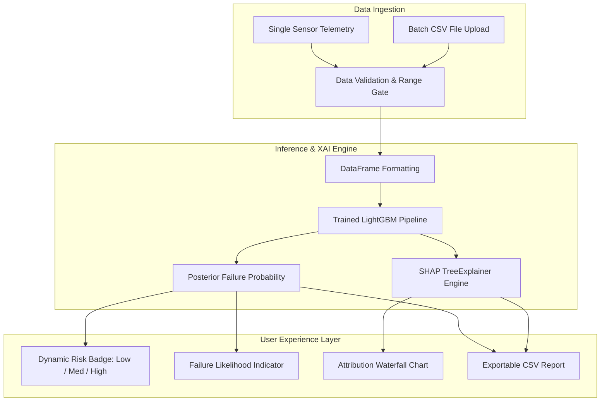

# 🏭 Industrial Predictive Maintenance: Explainable Machine Learning with LightGBM & SHAP

[](https://huggingface.co/spaces/iamvk09/predictive-maintenance-lgbm)
[](https://doi.org/10.55041/ijcope.v2i5.049)
[](docs/industrial-predictive-maintenance-research-paper.pdf)
[](https://github.com/iamvk09/Industrial-Predictive-Maintenance)
[](https://creativecommons.org/licenses/by/4.0/)
[](https://opensource.org/licenses/MIT)

> **Authors:** Vibhor Kumar · Rahul Shankar Pandey · Ridhesh Rajesh · Omkar Bhowmick · Dr. Savitha G.  
> **Institution:** Department of Computer Science & Engineering, RV Institute of Technology and Management (RVITM), Bengaluru  
> **Journal:** *International Journal of Creative and Open Research in Engineering and Management (IJCOPE)*, Vol. 02, Issue 05, May 2026 | **ISSN:** 3108-1754  

---

### 🔗 Quick Navigation & Resources
- [🚀 Try the Live Application](https://huggingface.co/spaces/iamvk09/predictive-maintenance-lgbm)
- [📄 Read the Published Research Paper (DOI)](https://doi.org/10.55041/ijcope.v2i5.049)
- [📥 Download the Research Paper PDF](docs/industrial-predictive-maintenance-research-paper.pdf)
- [💻 View the GitHub Repository](https://github.com/iamvk09/Industrial-Predictive-Maintenance)

---

## 📌 Table of Contents
- [Project Overview](#-project-overview)
- [Research Publication & Citations](#-research-publication--citations)
- [Research Abstract](#-research-abstract)
- [Research Problem & Motivation](#-research-problem--motivation)
- [Methodology & Class Imbalance Handling](#-methodology--class-imbalance-handling)
- [Comparative Evaluation of 5 Algorithms](#-comparative-evaluation-of-5-algorithms)
- [SHAP Explainability Findings](#-shap-explainability-findings)
- [System Architecture](#-system-architecture)
- [Interactive Application Features](#-interactive-application-features)
- [Technology Stack](#-technology-stack)
- [Installation and Local Execution](#-installation-and-local-execution)
- [Deployment on Hugging Face Spaces](#-deployment-on-hugging-face-spaces)
- [Project Structure](#-project-structure)
- [Practical Significance & System Limitations](#-practical-significance--system-limitations)
- [Future Improvements](#-future-improvements)
- [Contributors & Acknowledgements](#-contributors--acknowledgements)
- [License](#-license)

---

## 📖 Project Overview

This repository hosts both the **open-access research artifacts** and the **interactive web application** for our published study on intelligent equipment diagnostics in Industry 4.0 environments.

Unexpected machine breakdowns generate over **$50 billion in annual downtime losses** across global manufacturing plants. While modern smart factories record extensive sensor streams, deploying machine learning for predictive maintenance faces two foundational bottlenecks:
1. **Extreme Class Imbalance:** In well-maintained industrial plants, failure events comprise less than 4% of recorded operational telemetry.
2. **The "Black-Box" Problem:** Plant operators and maintenance engineers cannot act on automated alarms without understanding the underlying mechanical failure drivers.

Our project bridges this gap by presenting a calibrated **LightGBM** gradient boosted classifier integrated with a **SHAP (SHapley Additive exPlanations)** attribution framework, wrapped in an interactive, cloud-deployed **Gradio** web application for real-time failure prediction and root-cause explainability.

> ⚠️ **Research Prototype Disclaimer:** This application is developed and released as an academic research prototype and interactive demonstration. It is not certified for direct deployment in life-critical safety systems or automated fail-safe controllers without domain-specific validation and redundant industrial fail-safes.

---

## 📑 Research Publication & Citations

The research underlying this repository is peer-reviewed and published open-access in the *International Journal of Creative and Open Research in Engineering and Management (IJCOPE)*:

| Publication Property | Official Record Details |
| :--- | :--- |
| **Paper Title** | *Explainable Ensemble Learning for Industrial Predictive Maintenance Using SHAP and LightGBM* |
| **Authors** | Vibhor Kumar, Rahul Shankar Pandey, Ridhesh Rajesh, Omkar Bhowmick, Dr. Savitha G. |
| **Journal** | International Journal of Creative and Open Research in Engineering and Management (IJCOPE) |
| **Volume & Issue** | Volume 02, Issue 05 (May 2026) |
| **ISSN** | 3108-1754 |
| **Digital Object Identifier (DOI)** | [10.55041/ijcope.v2i5.049](https://doi.org/10.55041/ijcope.v2i5.049) |
| **Official Journal Link** | [https://doi.org/10.55041/ijcope.v2i5.049](https://doi.org/10.55041/ijcope.v2i5.049) |
| **Local Repository PDF** | [`docs/industrial-predictive-maintenance-research-paper.pdf`](docs/industrial-predictive-maintenance-research-paper.pdf) |
| **Paper License** | Creative Commons Attribution 4.0 International (CC BY 4.0) — Open Access |

### BibTeX Citation
```bibtex
@article{kumar2026explainable,
  title     = {Explainable Ensemble Learning for Industrial Predictive Maintenance Using SHAP and LightGBM},
  author    = {Kumar, Vibhor and Pandey, Rahul Shankar and Rajesh, Ridhesh and Bhowmick, Omkar and Savitha, G.},
  journal   = {International Journal of Creative and Open Research in Engineering and Management (IJCOPE)},
  volume    = {2},
  number    = {5},
  year      = {2026},
  month     = {May},
  issn      = {3108-1754},
  doi       = {10.55041/ijcope.v2i5.049},
  url       = {https://doi.org/10.55041/ijcope.v2i5.049}
}
```

---

## 📄 Research Abstract

> In Industry 4.0 manufacturing environments, unplanned machinery failure causes severe operational bottlenecks, unbudgeted repair costs, and catastrophic productivity downtime. Traditional maintenance regimes fluctuate between reactive firefighting and conservative scheduled inspections that waste usable component lifespans. This study proposes an intelligent, interpretable predictive maintenance architecture leveraging gradient boosted decision trees (**LightGBM**) coupled with cooperative game-theoretic interpretability (**SHAP**).
> 
> Evaluated on the benchmark **AI4I 2020 Predictive Maintenance Dataset** (10,000 instances exhibiting a severe 96.61% to 3.39% class imbalance), the pipeline incorporates **Synthetic Minority Over-sampling Technique (SMOTE)** to prevent majority-class bias. LightGBM demonstrates superior prognostic capability across 5 evaluated algorithms, obtaining **97.85% Accuracy**, an **F1-Score of 0.7514**, and a critical **Recall of 95.59%**, successfully anticipating **65 of 68 test failure instances**. Global and local SHAP attributions demonstrate that mechanical **Torque (1.5035)**, cumulative **Tool Wear (0.8527)**, and **Heat Dissipation (0.7035)** are the paramount physical predictors of operational breakdown, providing plant teams with actionable, transparent guidance.

---

## 🎯 Research Problem & Motivation

In automated manufacturing, predictive maintenance algorithms face distinct evaluation challenges:
- **The Pitfall of Raw Accuracy:** In a dataset with 96.61% normal operation, a trivial "dummy" classifier predicting *Normal* 100% of the time scores 96.61% accuracy while detecting **0%** of breakdowns. For critical industrial assets, raw classification accuracy is insufficient.
- **Why Recall and F1-Score Dominate:** A false negative (missing a true machine failure) leads to catastrophic stoppage and tool destruction, whereas a false positive merely triggers a quick manual inspection. Therefore, **Recall (Sensitivity)** and the **F1-Score** are the decisive metrics.
- **Interpretable Alarms:** Operators will not shut down production lines based on opaque neural networks. By attributing every prediction to specific physical quantities (torque spikes, thermal dissipation limits, tool wear limits), maintenance staff can immediately identify whether a motor needs lubrication, a tool bit requires replacement, or cooling lines are obstructed.

---

## ⚙️ Methodology & Class Imbalance Handling

```
[Raw AI4I Telemetry: 10,000 Samples]
                  │
                  ▼
[Stratified 80/20 Train/Test Partition]
        ├── Train Set: 8,000 samples (271 Failures / 7,729 Normal)
        └── Test Set:  2,000 samples (68 Failures / 1,932 Normal)
                  │
                  ▼
[SMOTE Oversampling on Train Fold Only]
        └── Synthesized minority failure vectors to balance 1:1 (7,729 Normal : 7,729 Failure)
                  │
                  ▼
[Algorithm Benchmark & Hyperparameter Tuning]
        └── LightGBM: 100 trees, depth 6, learning rate 0.1
                  │
                  ▼
[Model Inference & TreeExplainer Game-Theoretic SHAP Attribution]
```

To eliminate data leakage, resampling was isolated strictly within the training fold. **SMOTE (Synthetic Minority Over-sampling Technique)** constructs synthetic feature vectors between minority class nearest neighbors, allowing the LightGBM split criteria to formulate sharp decision boundaries around rare failure clusters.

---

## 📊 Comparative Evaluation of 5 Algorithms

The published paper benchmarked 5 distinct machine learning paradigms evaluated on the identical 2,000-sample held-out test set (68 true failure events):

| Algorithm | Accuracy | F1-Score | Recall (Sensitivity) | Precision | Failure Detection (Test Set) |
| :--- | :---: | :---: | :---: | :---: | :---: |
| **LightGBM (Proposed)** ⭐ | **97.85%** | **0.7514** | **95.59%** | **0.6190** | **65 / 68 Failures Detected** |
| **Random Forest (Baseline)** | 97.25% | 0.7027 | 95.59% | 0.5560 | 65 / 68 Failures Detected |
| **XGBoost** | 97.80% | 0.7470 | 94.12% | 0.6210 | 64 / 68 Failures Detected |
| **Stacking Ensemble** | 97.75% | 0.7430 | 94.12% | 0.6120 | 64 / 68 Failures Detected |
| **Support Vector Machine (SVM)** | 79.10% | 0.2260 | 72.06% | 0.1340 | 49 / 68 Failures Detected |

### Research Takeaway
While Random Forest captured an identical 65 failure instances, LightGBM reduced false positives from 41 to 27, driving a **+5.71% relative improvement in F1-score** (0.7514 vs 0.7027) while executing training and prediction significantly faster.

---

## 🔬 SHAP Explainability Findings

Using the cooperative game-theoretic **SHAP TreeExplainer**, the relative contribution of each parameter to machine failure log-odds was quantified:

| Rank | Parameter / Sensor Reading | Mean \|SHAP Value\| (Impact on Log-Odds) | Physical Engineering Context |
| :---: | :--- | :---: | :--- |
| **1** | **Torque [Nm]** | **1.5035** | Mechanical overload; excessive spindle stress preceding tool breakage |
| **2** | **Tool Wear [min]** | **0.8527** | Cumulative abrasive blade wear leading to catastrophic tool failure |
| **3** | **Heat Dissipation Failure (HDF)** | **0.7035** | Sub-optimal difference between ambient and process temperatures |
| 4 | Power Failure Indicator (PWF) | 0.6892 | Incongruity between spindle speed and applied rotational torque |
| 5 | Rotational Speed [rpm] | 0.6745 | High-speed kinematic vibrations or anomalous low-speed stall torque |
| 6 | Overstrain Failure (OSF) | 0.4521 | Torque-wear product boundary exceedance |
| 7 | Process Temperature [K] | 0.3128 | Thermal gradient within manufacturing casing |
| 8 | Tool Wear Failure (TWF) | 0.2845 | Total threshold duration exhaustion |
| 9 | Air Temperature [K] | 0.1523 | Ambient factory temperature |
| 10 | Product Type (L/M/H) | 0.0892 | Component manufacturing variant grade |

> 📌 *Note: The values above represent mean absolute SHAP values (additive contributions to model log-odds output), not percentage proportions.*

---

## 🏗 System Architecture



---

## 💻 Interactive Application Features

The deployed Gradio application implements four dedicated workspaces:

### 1. 🔍 Single Real-Time Telemetry Prediction
- Interactive sliders for the 6 continuous operational features:
  - `Product Type` (0=Low, 1=Medium, 2=High)
  - `Air Temperature` (295.0 – 305.0 K)
  - `Process Temperature` (305.0 – 315.0 K)
  - `Rotational Speed` (1200 – 2900 rpm)
  - `Torque` (3.0 – 80.0 Nm)
  - `Tool Wear` (0 – 250 min)
- Instant **Normal** vs **High-Risk** preset buttons for interactive benchmarking.
- Instant failure probability gauge and risk band categorization.
- Real-time horizontal SHAP attribution chart displaying feature vectors pulling toward or against mechanical breakdown.

### 2. 📂 Batch Telemetry Prediction
- Bulk CSV ingestion supporting thousands of simultaneous telemetry observations.
- Automatic column matching for: `Type, Air_temp, Process_temp, Rotation_speed, Torque, Tool_wear`.
- Live KPI executive dashboard: total records, predicted failure counts, overall failure rate, and risk tier distribution.
- One-click downloadable CSV containing appended probabilities, predictions, and risk ratings.

### 3. 📊 Model Information & Research Analytics
- Embedded visual comparisons of the 5 benchmarked algorithms.
- Full confusion matrix visualizations (Random Forest vs LightGBM on the 2,000-sample test set).
- Complete dataset summary and hyperparameter specifications.

### 4. ℹ️ About & Research Attribution
- Direct links to the published IJCOPE paper and DOI.
- Research team background and institution credits.
- UN Sustainable Development Goal 9 (Industry, Innovation, and Infrastructure) alignment.

---

## 🛠 Technology Stack

| Component | Library / Framework | Version | Purpose |
| :--- | :--- | :---: | :--- |
| **Model Architecture** | `LightGBM` | `4.5.0` | High-efficiency gradient boosting classifier |
| **Explainable AI (XAI)** | `SHAP` | `0.46.0` | Game-theoretic feature attribution via `TreeExplainer` |
| **Machine Learning Core** | `scikit-learn` | `1.5.2` | Resampling, pipeline structure, evaluation matrices |
| **Data Processing** | `pandas` / `numpy` | `2.2.3` / `1.26.4` | Tabular data manipulation and vectorization |
| **User Interface** | `Gradio` | `4.44.0` | Web dashboard, sliders, responsive layout |
| **Plot Rendering** | `matplotlib` | `3.9.2` | Publication figures and SHAP attribution plots |
| **Deployment** | `Docker` / `Hugging Face Spaces` | Containerized | Cloud application hosting with public accessibility |

---

## 💻 Installation and Local Execution

### Prerequisites
- Python `3.10`, `3.11`, or `3.12`
- `git`

### 1. Clone the Repository
```bash
git clone https://github.com/iamvk09/Industrial-Predictive-Maintenance.git
cd Industrial-Predictive-Maintenance
```

### 2. Set Up Virtual Environment
```bash
# macOS / Linux
python3 -m venv .venv
source .venv/bin/activate

# Windows (PowerShell)
python -m venv .venv
.venv\Scripts\Activate.ps1
```

### 3. Install Dependencies
```bash
pip install --upgrade pip
pip install -r requirements.txt
```

### 4. Run the Application
```bash
python app.py
```
Open your browser and navigate to:
```
http://localhost:7860
```

---

## ☁️ Deployment on Hugging Face Spaces

The live application is hosted on **Hugging Face Spaces**:
- **Live Space:** [https://huggingface.co/spaces/iamvk09/predictive-maintenance-lgbm](https://huggingface.co/spaces/iamvk09/predictive-maintenance-lgbm)

### Configuration Architecture
Hugging Face Spaces parses the YAML frontmatter block at the top of the root `README.md` within the Space's Git repository:
```yaml
---
title: Industrial Predictive Maintenance - LightGBM + SHAP
emoji: 🏭
colorFrom: blue
colorTo: indigo
sdk: gradio
sdk_version: 4.44.0
app_file: app.py
pinned: false
license: mit
tags:
  - predictive-maintenance
  - lightgbm
  - shap
  - explainable-ai
  - industry-4.0
  - machine-learning
---
```

To keep the GitHub portfolio presentation clean (preventing GitHub from converting the YAML header into an unwanted table), a dedicated Space-ready file is maintained in [`README_SPACE.md`](README_SPACE.md).

---

## 📂 Project Structure

```
Industrial-Predictive-Maintenance/
├── docs/
│   └── industrial-predictive-maintenance-research-paper.pdf  # Published paper PDF (CC BY 4.0)
├── app.py                      # Complete Gradio application (UI, inference, SHAP generation)
├── requirements.txt            # Pinned production dependencies
├── lgbm_model.pkl              # Pre-trained LightGBM classification pipeline
├── Dockerfile                  # Container definition for containerized hosting
├── DEPLOYMENT_GUIDE.md         # Step-by-step deployment reference
├── README_SPACE.md             # Space documentation (containing required HF YAML frontmatter)
├── .gitignore                  # Clean Git exclusions (.venv, caches, temp files)
└── README.md                   # GitHub portfolio and research showcase documentation
```

---

## ⚖️ Practical Significance & System Limitations

### Practical Significance
- **Cost Reduction:** Enables condition-based maintenance, minimizing catastrophic equipment destruction and reducing unneeded part replacements by servicing components only when probability exceeds thresholds.
- **Explainable Trust:** Field engineers are presented with clear mechanical indicators (e.g. Torque overload vs Tool Wear degradation) instead of arbitrary percentage scores.

### Limitations & Scope
- **Benchmark Specificity:** The model is trained on the synthetic AI4I 2020 dataset reflecting CNC milling telemetry; real plant equipment will require fine-tuning or domain adaptation.
- **Sensor Coverage:** The prototype tracks 6 operational variables; real-world plants often monitor high-frequency acoustic emissions and 3-axis vibration spectra.
- **Not a Safety-Critical Controller:** This software serves as an operator decision-support dashboard and is not intended to replace hardware interlocks or emergency shutdown systems.

---

## 🔮 Future Improvements

- [ ] **Multi-Class Failure Classification:** Disaggregate binary failure into specific root-cause modes (Tool Wear Failure, Heat Dissipation, Power Failure, Overstrain).
- [ ] **Remaining Useful Life (RUL) Modeling:** Incorporate Weibull survival analysis or LSTM networks to forecast operating hours remaining before threshold breach.
- [ ] **Edge Gateway Integration:** Deploy containerized inference to edge industrial gateways via MQTT or OPC-UA protocols.
- [ ] **Automated Work-Order Generation:** One-click maintenance report generation in downloadable PDF format.

---

## 👥 Contributors & Acknowledgements

### Authors
- **Vibhor Kumar** — Department of Computer Science & Engineering, RVITM Bengaluru ([GitHub](https://github.com/iamvk09))
- **Rahul Shankar Pandey** — Department of Computer Science & Engineering, RVITM Bengaluru
- **Ridhesh Rajesh** — Department of Computer Science & Engineering, RVITM Bengaluru
- **Omkar Bhowmick** — Department of Computer Science & Engineering, RVITM Bengaluru
- **Dr. Savitha G.** — Faculty Supervisor & Guide, Department of Computer Science & Engineering, RVITM Bengaluru

**Institution:** Department of Computer Science & Engineering, RV Institute of Technology and Management (RVITM), Bengaluru, Karnataka, India.

---

## 📜 License

- **Source Code & Application:** Licensed under the [MIT License](LICENSE).
- **Research Publication:** Published Open Access under the [Creative Commons Attribution 4.0 International License (CC BY 4.0)](https://creativecommons.org/licenses/by/4.0/).
