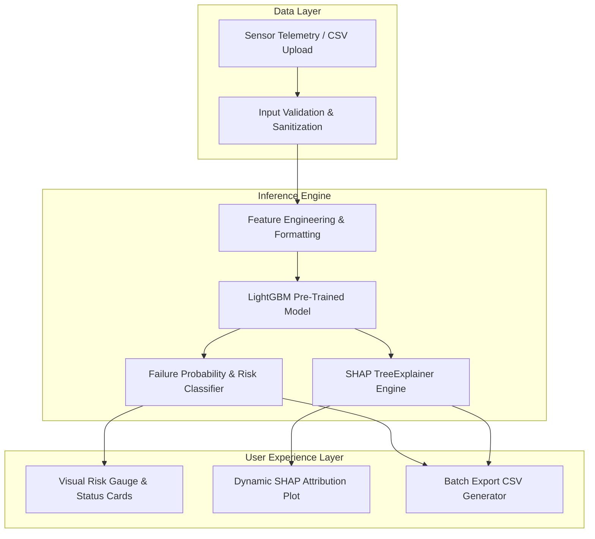

# 🏭 Industrial Predictive Maintenance: Explainable Machine Learning with LightGBM & SHAP

[](https://huggingface.co/spaces/iamvk09/predictive-maintenance-lgbm)
[](https://github.com/iamvk09/Industrial-Predictive-Maintenance)
[](https://opensource.org/licenses/MIT)
[](https://www.python.org/)
[](https://gradio.app/)
[](https://lightgbm.readthedocs.io/)
[](https://shap.readthedocs.io/)

> **Authors:** Vibhor Kumar · Rahul Shankar Panday · Ridesh Rajesh  
> **Institution:** Department of Computer Science & Engineering, RV Institute of Technology and Management (RVITM), Bengaluru  
> **Direct Live Application:** [🚀 Try the Live Application on Hugging Face Spaces](https://huggingface.co/spaces/iamvk09/predictive-maintenance-lgbm)

---

## 📌 Table of Contents
- [Live Demo & Repository](#-live-demo--repository)
- [Project Overview](#-project-overview)
- [Key Features](#-key-features)
- [Technology Stack](#-technology-stack)
- [System Architecture](#-system-architecture)
- [Machine Learning Workflow](#-machine-learning-workflow)
- [Dataset Specifications](#-dataset-specifications)
- [Model Performance & Evaluation](#-model-performance--evaluation)
- [SHAP Explainability](#-shap-explainability)
- [Application Walkthrough](#-application-walkthrough)
  - [Single Prediction](#single-prediction)
  - [Batch Prediction](#batch-prediction)
  - [Model Information](#model-information)
  - [About Tab](#about-tab)
- [Installation and Local Setup](#-installation-and-local-setup)
- [Running the Application](#-running-the-application)
- [Deployment on Hugging Face Spaces](#-deployment-on-hugging-face-spaces)
- [Project Structure](#-project-structure)
- [Future Improvements](#-future-improvements)
- [UN SDG 9 Alignment](#-un-sdg-9-alignment)
- [Contributors & Credits](#-contributors--credits)
- [License](#-license)

---

## 🌐 Live Demo & Repository

- **🚀 Live Application:** [https://huggingface.co/spaces/iamvk09/predictive-maintenance-lgbm](https://huggingface.co/spaces/iamvk09/predictive-maintenance-lgbm)
- **💻 GitHub Repository:** [https://github.com/iamvk09/Industrial-Predictive-Maintenance](https://github.com/iamvk09/Industrial-Predictive-Maintenance)

---

## 📖 Project Overview

Unplanned machine downtime is estimated to cost global industrial manufacturers over **$50 billion annually**. Traditional reactive maintenance (repairing after failure) creates severe downtime, while conventional time-based preventive maintenance frequently leads to unnecessary part replacements and elevated labor expenditures.

This project delivers an end-to-end, production-ready **Industrial Predictive Maintenance System** aligned with Industry 4.0 paradigms. Combining a calibrated **LightGBM** gradient boosted classifier with **SHAP (SHapley Additive exPlanations)**, the application predicts equipment failures before catastrophic breakdowns occur and provides plant operators with real-time, transparent root-cause feature attributions for every operational decision.

---

## ✨ Key Features

- **⚡ Real-Time Single Inferences:** Interactive telemetry sliders for 6 continuous operating parameters with instantaneous risk categorization (Low, Medium, High).
- **🔬 Explainable AI (XAI):** Built-in **SHAP TreeExplainer** generating horizontal feature attribution waterfall charts indicating which operational factors drive failure likelihood up or down.
- **📂 High-Throughput Batch Processing:** Upload multi-row CSV telemetry datasets to generate bulk failure predictions, calculate aggregate metrics, and download enriched result files.
- **🛡️ Robust Input Validation:** Boundary checking on all sensor inputs to catch physically out-of-range parameters and malformed CSV formats with actionable alert dialogs.
- **🎨 High-Contrast Industrial Dark UI:** Built with Gradio using WCAG-compliant slate/dark color schemes and accessible text contrast across all desktop and mobile viewports.
- **📊 Embedded Scientific Analytics:** Dedicated Model Information panel visualizing baseline comparisons, feature importance, and test confusion matrices directly derived from research benchmarks.

---

## 🛠 Technology Stack

| Domain | Technology / Library | Purpose |
| :--- | :--- | :--- |
| **Machine Learning** | `LightGBM 4.5.0` | High-efficiency gradient boosting classifier |
| **Explainable AI** | `SHAP 0.46.0` | TreeExplainer game-theoretic feature attribution |
| **Preprocessing & Resampling** | `scikit-learn 1.5.2` | Data splitting, evaluation metrics, pipeline handling |
| **Data Processing** | `pandas 2.2.3`, `numpy 1.26.4` | Matrix computations and tabular feature engineering |
| **Application UI** | `Gradio 4.44.0` | Responsive web dashboard and interactive widgets |
| **Visualization** | `matplotlib 3.9.2` | Publication-ready confusion matrices & SHAP figures |
| **Deployment** | `Docker`, `Hugging Face Spaces` | Containerized cloud deployment with zero server setup |

---

## 🏗 System Architecture



---

## 🔄 Machine Learning Workflow

1. **Telemetry Ingestion:** Real-time sensor readings (`Type`, `Air_temp`, `Process_temp`, `Rotation_speed`, `Torque`, `Tool_wear`) are captured via the Gradio interface or batch CSV files.
2. **Pre-inference Validation:** Inputs are checked against physical operating constraints to ensure data integrity and prevent out-of-distribution pipeline errors.
3. **Imbalance-Aware Training:** Models were trained on the UCI AI4I 2020 dataset using **SMOTE (Synthetic Minority Over-sampling Technique)** to overcome the 96.6% vs. 3.4% severe class imbalance.
4. **Ensemble Classification:** The LightGBM classifier estimates posterior failure probability with custom operational risk thresholds:
   - 🟢 **Low Risk:** Probability < 40%
   - 🟡 **Medium Risk:** 40% ≤ Probability ≤ 70%
   - 🔴 **High Risk:** Probability > 70%
5. **Game-Theoretic Attribution:** The SHAP TreeExplainer calculates exact Shapley values for each feature relative to the expected model base value, surfacing the mechanical reasons behind the prediction.

---

## 🗂 Dataset Specifications

The model was trained and evaluated on the benchmark **AI4I 2020 Predictive Maintenance Dataset** hosted on the UCI Machine Learning Repository:

- **Total Samples:** 10,000 synthetic observations reflecting real milling machine operations.
- **Target Variable:** Binary `Machine failure` flag (0 = Normal, 1 = Failure).
- **Severe Class Imbalance:** 9,661 Normal operational points (96.61%) vs. 339 Failure occurrences (3.39%).
- **Data Partition:** 80% Training set (with stratified SMOTE oversampling) / 20% Held-out Test set (2,000 real-world samples).

### Feature Reference Guide

| Feature Name | Type | Range / Units | Description & Industrial Context |
| :--- | :--- | :--- | :--- |
| `Type` | Categorical | `0 (L)`, `1 (M)`, `2 (H)` | Product quality variant (Low 50%, Medium 30%, High 20%) |
| `Air_temp` | Continuous | 295.0 – 305.0 K | Ambient room air temperature |
| `Process_temp` | Continuous | 305.0 – 315.0 K | Dynamic manufacturing process temperature |
| `Rotation_speed`| Continuous | 1200 – 2900 rpm | Spindle velocity calculated from power consumption |
| `Torque` | Continuous | 3.0 – 80.0 Nm | Mechanical torque load (**Primary failure indicator**) |
| `Tool_wear` | Continuous | 0 – 250 min | Cumulative tool wear duration (**Secondary indicator**) |

---

## 📈 Model Performance & Evaluation

The LightGBM model was tested against standard industrial baselines on the 2,000-sample test set (containing 68 actual failure events):

| Evaluation Metric | LightGBM (Selected) ⭐ | Random Forest (Baseline) | SVM (Baseline) | XGBoost | Stacking Ensemble |
| :--- | :---: | :---: | :---: | :---: | :---: |
| **Accuracy** | **97.85%** | 97.25% | 79.10% | 97.80% | 97.75% |
| **F1-Score** | **0.7514** | 0.7027 | 0.2260 | 0.7470 | 0.7430 |
| **Recall (Sensitivity)** | **95.59%** | 95.59% | 72.06% | 94.12% | 94.12% |
| **Precision** | **0.6190** | 0.5560 | 0.1340 | 0.6210 | 0.6120 |
| **Failure Detection Rate** | **65 / 68** | 65 / 68 | 49 / 68 | 64 / 68 | 64 / 68 |

> **Key Performance Takeaway:** LightGBM achieves a **+5.71% F1-score improvement** over Random Forest while maintaining a 95.59% recall rate, drastically reducing false alarms without missing true failure events.

---

## 🔬 SHAP Explainability

Black-box models are unacceptable in mission-critical manufacturing. By integrating **SHAP TreeExplainer**, our solution computes exact Shapley values to illustrate how each feature alters failure probability:

```
Torque [Nm]            ████████████████████████ (1.5035)  ⭐ #1 Stress Factor
Tool Wear [min]        █████████████            (0.8527)  ⭐ #2 Wear Factor
Heat Dissipation Flag  ███████████              (0.7035)  ⭐ #3 Thermal Factor
Rotational Speed [rpm] ██████████               (0.6745)
Process Temp [K]       █████                    (0.3128)
Air Temp [K]           ██                       (0.1523)
Product Type           █                        (0.0892)
```

- **Torque & Tool Wear:** Account for over 65% of total predictive attribution.
- **Red Bars:** Pull predictions toward equipment failure (high operational risk).
- **Blue Bars:** Anchor predictions in safe, normal operating zones.

---

## 🖥️ Application Walkthrough

### Single Prediction
1. Navigate to the **🔍 Single Prediction** tab.
2. Adjust the sliders or click **✅ Normal Operation Preset** / **⚠️ High-Risk Preset** for instantaneous demonstration.
3. Click **🔮 Predict Failure Risk** to generate:
   - Clear classification header (`NORMAL OPERATION` or `FAILURE PREDICTED`).
   - Numerical failure probability (%) and risk category.
   - Dynamic SHAP waterfall chart breaking down each sensor's contribution.

### Batch Prediction
1. Open the **📂 Batch Prediction** tab.
2. Upload a CSV file matching the schema:
   ```csv
   Type,Air_temp,Process_temp,Rotation_speed,Torque,Tool_wear
   1,300.0,310.0,1500,40.0,100
   0,302.5,312.0,1200,75.0,220
   ```
3. Click **⚡ Run Batch Prediction**.
4. View the KPI distribution dashboard (Total Samples, Failure Rate, Risk Breakdown).
5. Download the annotated predictions CSV directly to your local workstation.

### Model Information
Inspect comparative bar charts, confusion matrices (RF vs. LightGBM), hyperparameters, and dataset statistics directly within the application.

### About Tab
Review project metadata, research abstract, team affiliations, and literature links.

---

## 💻 Installation and Local Setup

### Prerequisites
- Python `3.10`, `3.11`, or `3.12`
- `git`

### Step 1: Clone the Repository
```bash
git clone https://github.com/iamvk09/Industrial-Predictive-Maintenance.git
cd Industrial-Predictive-Maintenance
```

### Step 2: Create and Activate Virtual Environment
```bash
# macOS / Linux
python3 -m venv .venv
source .venv/bin/activate

# Windows (PowerShell)
python -m venv .venv
.venv\Scripts\Activate.ps1
```

### Step 3: Install Required Dependencies
```bash
pip install --upgrade pip
pip install -r requirements.txt
```

---

## 🚀 Running the Application

Launch the local Gradio development server:
```bash
python app.py
```
Open your browser and navigate to:
```
http://localhost:7860
```

---

## ☁️ Deployment on Hugging Face Spaces

This application is deployed on **Hugging Face Spaces** using the native Gradio SDK.

- **Live Application:** [https://huggingface.co/spaces/iamvk09/predictive-maintenance-lgbm](https://huggingface.co/spaces/iamvk09/predictive-maintenance-lgbm)

### Space Configuration
Hugging Face Spaces reads its configuration from the YAML frontmatter in `README.md` on the Space repository:
```yaml
---
title: Industrial Predictive Maintenance - LightGBM + SHAP
emoji: 🏭
colorFrom: blue
colorTo: indigo
sdk: gradio
sdk_version: 4.44.0
app_file: app.py
pinned: false
license: mit
tags:
  - predictive-maintenance
  - lightgbm
  - shap
  - explainable-ai
  - industry-4.0
  - machine-learning
---
```

---

## 📂 Project Structure

```
Industrial-Predictive-Maintenance/
├── app.py                  # Full Gradio application (UI, inference, SHAP generation)
├── requirements.txt        # Pinned production dependencies
├── lgbm_model.pkl          # Pre-trained LightGBM classification pipeline
├── Dockerfile              # Container definition for portable environments
├── DEPLOYMENT_GUIDE.md     # Detailed deployment instructions for cloud platforms
├── README_SPACE.md         # Space deployment documentation (with HF YAML frontmatter)
├── .gitignore              # Clean Git exclusions (virtualenvs, cache, temp files)
└── README.md               # GitHub portfolio presentation documentation
```

---

## 🔮 Future Improvements

- [ ] **Multi-Class Fault Diagnosis:** Extend inference beyond binary failure to identify specific failure modes (`TWF`, `HDF`, `PWF`, `OSF`, `RNF`).
- [ ] **Remaining Useful Life (RUL) Estimation:** Train survival analysis models to predict exact hours before required maintenance.
- [ ] **Real-time MQTT / Kafka Stream Ingestion:** Ingest real-time sensor streams from simulated industrial IoT edge gateways.
- [ ] **Automated PDF Maintenance Reports:** Generate one-click downloadable maintenance work-order PDFs.

---

## 🌱 UN SDG 9 Alignment

This research advances **United Nations Sustainable Development Goal 9 (Industry, Innovation, and Infrastructure)** by:
- Enabling data-driven maintenance strategies that prevent catastrophic machine breakdown.
- Minimizing industrial equipment scrapping and replacement component waste.
- Increasing operational energy efficiency and smart manufacturing reliability.

---

## 👥 Contributors & Credits

- **Vibhor Kumar** — Department of Computer Science & Engineering, RVITM Bengaluru
- **Rahul Shankar Panday** — Department of Computer Science & Engineering, RVITM Bengaluru
- **Ridesh Rajesh** — Department of Computer Science & Engineering, RVITM Bengaluru

**Institution:** Department of Computer Science & Engineering, RV Institute of Technology and Management, Bengaluru, Karnataka, India.

---

## 📜 License

This project is licensed under the [MIT License](LICENSE) — free for academic, research, and open-source use.

